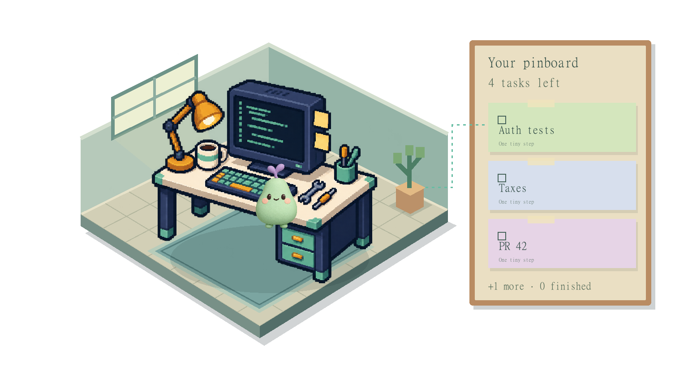

# Daytown

Daytown is a voice-first task app for easily distracted builders. A spoken brain dump becomes editable tasks and deadlines in a pixel-art workbench. A small, transparent desktop pet helps you return to the next step without covering your work.

The app is the starting point. Chrome integration is optional, and Daytown leaves Google's new tab, search, shortcuts and browser settings alone.



[Watch the 84-second Daytown demo](demo-assets/Daytown-demo.mp4) · [Download the MP4](https://raw.githubusercontent.com/HLEOT/hackathon_codex_nov26/main/demo-assets/Daytown-demo.mp4)

This captioned video is a **rendered walkthrough with fictional tasks**, not a screen recording. Accelerated demo timings are labelled throughout. Live microphone recognition and spoken task completion were separately confirmed during the hackathon.

## Run the application

Install Node.js **24 or newer**, then run:

```sh
npm install --omit=dev
# Copy .env.example to .env and set OPENAI_API_KEY locally.
npm start
```

On Windows, `npm start` opens the standalone Daytown application automatically. Its native window uses Microsoft's WebView2; the transparent pet is a separate native overlay, not a Chrome pop-out. The first app launch restores the official WebView2 SDK when needed and compiles the small Windows executables into ignored `runtime/`. It does not change Windows execution policy or other system protections. The WebView2 runtime is required and is already present on most current Windows systems.

For the hackathon workstation's local npm runner, use `.\npm.cmd start`; a fresh clone should use standard npm. `npm run app` reopens the app when its server is already running, and `npm run desktop` opens just the pet. The optional web view is [localhost:3000](http://localhost:3000). Cached fictional art is restored automatically, so the sample workspace needs no image calls during a demo.

The API key stays in the server's `.env`. It is never included in the extension, native UI or renderer. All model names are configurable in `.env.example` and `.env`.

## Capture a task and check the dates

Hold the microphone and say, “Fix auth tests tomorrow at ten, and review PR 42 Friday at two.” You can also type a thought or choose an example.

Daytown shows the actual transcript and a review screen before saving. You can correct task names, first steps, due dates and reminder times. Dates are shown explicitly in **London time**, including weekday, date, year and time. A new task with a day but no time defaults to 18:00, and the review explains that assumption. Nothing is saved until you choose **Save tasks**; Cancel leaves your tasks unchanged.

The transcription request includes coding vocabulary such as auth tests, pull requests, CI and TypeScript. These hints improve recognition but do not guarantee it, which is why corrections remain editable. Day-only moves preserve an appointment's existing time. Invalid dates, daylight-saving gaps and ambiguous clock-change times receive field-specific feedback rather than being silently shifted.

The active task offers one first step with **Ready for 5 min**, **Done**, **Take a 5 min break** and **Later 15 min** controls. **Tasks** opens the complete list; **Work on this** swaps the active task and keeps elapsed time with the task you left. The manual work timer continues while you code in other windows, pauses on a break or Pause, and excludes server downtime. The five-minute focus countdown is shown separately from total time worked. Voice commands use one strict Structured Outputs parser for add, done, move, remind, what's next, snooze, show my week, ready and gassed.

## Connect your Codex pet

Choose **Connect Codex** in the app. Daytown detects the selected pet from the local desktop app's cached selection and reuses its existing sprite sheet. A successful connection is shown by name, for example “Biscuit is connected.” Personal pet artwork stays in ignored local `data/`, not in this public repository. Reconnect is available under Pet settings when you change companions.

This is a read-only appearance bridge to the installed Codex/ChatGPT desktop app. Daytown does not modify your Codex pet record, borrow account credentials, or claim control of Codex's existing floating window. Tasks, health and reminder behavior run in Daytown's own standalone pet application. The local cache format is not a public SDK and may need adaptation after app updates; if Codex has not cached a compatible pet, open its pet picker once and reconnect. Generic demo artwork remains available as a fallback.

Click **Pin workbench** when you want a desktop companion. A small, transparent 340 × 270 window shows one pet working at one pixel desk, with a cute pinboard that counts every remaining task and shows the next few notes. Empty pixels click through to the application underneath. Hover reveals the next step and controls; drag the desk to move it. Walking and AI voice are off by default. Brief reminder signs, subtle feeding animation and a fading ghost stay within the small window. The visible timer bar shows the current focus or break progress even while an egg waits for a finished step. The hover-only voice control can enable a short generated reminder line even when the main app is closed.

## Pressure, health and the graveyard

Pressure rises for overdue tasks and after a thirty-minute stretch without a response. An unacknowledged Codex completion raises it about three times faster. The pet grows and changes from amber to orange to red, with brief prompts at pressure thresholds. Focus blocks and declared breaks pause pressure and health drain. At 100 it exits in cartoon confetti, leaves a permanent grave and becomes an egg after its ghost animation. Swapping tasks or responding clears pressure. Demo controls can set pressure directly.

Finishing a step feeds the pet and celebrates the corresponding task note. Overdue tasks and prolonged neglect gradually reduce health through hungry, sick and critical stages. A short focus timer pauses that drain while you start.

At zero health, the pet becomes a ghost and leaves a permanent grave with a playful, kind epitaph. Its replacement egg hatches only when a tiny step is completed; adding more tasks cannot hatch it. **History** opens the graveyard, including each companion’s portrait, birth and departure dates, completed-task count, and playful epitaph. Older saved graves keep their existing information. It is intended to be funny and forgiving, never cruel or shaming.

Reminders are delivered once per scheduled occurrence. Pending reminders survive closed tabs and reconnects, and an atomic server claim prevents duplicate speech or notifications across views. A global pet-presence heartbeat suppresses optional system notifications while a pet is visible. Sound and notifications require opting in.

The interface uses sentence-case labels and editable examples. Light, dark and system themes keep the task workflow readable without adding a new screen to manage.

## Talk from the corner workshop

Hover over the transparent workbench and choose **Talk**. A small native application card opens with the same pet, all tasks, work/focus/break timers and a single-tap **Talk** button. It listens until you pause, then stops automatically. Try “Auth tests are done”, “I’m gassed”, or “I’m ready”. You can type instead. Clear spoken completion reports are applied automatically, including several completed tasks and a readiness update in one sentence. Daytown acknowledges the actual changes aloud using a short response generated in the same Structured Outputs call. If the target is unclear, it asks a spoken question and changes no tasks. Typed commands retain a preview and editable target. New tasks open the main app’s editable review before saving. Replies can use a clearly labelled AI voice; listening stops playback to avoid echo. The microphone runs only for an explicitly started Talk capture, stops after speech or a maximum of 45 seconds, and discards recordings with no detected speech.

The companion card and main app share a local WebView2 profile. Neither contains an API key. Closing the voice card leaves the transparent workbench available.

## Link Codex activity

Pet appearance and agent activity are separate connections. **Pet settings → Link Codex activity** installs the documented user-level notify hook for **new Codex sessions**. The existing notify command is preserved in a chain, and an exact configuration backup stays in ignored runtime/. Only completion type and thread/turn identifiers reach Daytown; prompts and assistant messages are not sent. Restart the relevant Codex session once after linking. The app reports the last actual completion separately from the same-pet appearance link.

The optional npm run codex command launches Codex with completion reporting; npm run smoke:codex checks a real read-only turn. The global hook reports completed turns; the optional runner also marks when its run starts. Daytown does not control Codex’s own floating pet or automatically start coding tasks. See the [official notification format](https://learn.chatgpt.com/docs/config-file/config-advanced#notifications) and [user-level notification configuration](https://learn.chatgpt.com/docs/config-file/config-reference).

## Optional Chrome panel

The application works without an extension. To add the side panel, open `chrome://extensions` yourself, enable Developer mode, choose **Load unpacked**, and select `extension/`. Open Daytown from Chrome's Extensions menu or pin its toolbar icon. The panel opens only on request and caches its last workspace for offline viewing.

If an early hackathon version replaced your new tab, disable or reload that old extension and open a fresh tab. The current manifest contains neither `chrome_url_overrides` nor `chrome_settings_overrides`; it does not change Google search or shortcuts. No API key, remote script or external font is included in the extension.

## Demo and verification

Run `npm run seed` for a fictional sample week, or use **Demo controls**. Seeding resets the demo tasks and pet while preserving graves; it is a debug reset, not part of ordinary egg recovery. Fast-forward changes Daytown's clock, not the computer clock. Health, death and celebration controls make the full sequence reproducible. Label accelerated waiting in recordings.

The weekly poster downloads a locally composited PNG of the workbench, completed tasks, graveyard, current pet and counts. [DEMO_SCRIPT.md](DEMO_SCRIPT.md) describes the intended 90-second recording. A video is only claimed complete once its file and duration have been checked.

```sh
npm install
npm test
npm run typecheck
npm run smoke
npm run smoke -- --live path/to/spoken.wav
```

Observed checks include live image generation/editing, a recorded four-task brain dump, strict deadline extraction, appointment-time preservation, TTS, browser completion/death/egg recovery, and native overlay presence/transparency. The actual user microphone path worked, and its auth/orth confusion prompted coding-vocabulary hints and editable task names. Tests cover parser/draft safety, London dates, health, atomic persistence, reminder replay/claims, pet presence, compositor bounds/escaping/caches and Chrome settings preservation. Detailed results are in [CODEX_LOG.md](CODEX_LOG.md).

## Architecture and privacy

Node, TypeScript and Express serve the application with SSE updates. Task state is atomically saved in local `data/state.json`. Sharp composites one transparent pixel workbench, task notes, paths and memorials. The selected pet is animated separately from its existing working frames, so no second character is baked into the artwork. CSS supplies restrained effects. Generated images are cached; placeholders keep interaction responsive during generation. Scene calls are tied to a change of next task rather than opening a view.

`demo-assets/` contains only fictional, checksummed workbench art and a generic fallback pet. Actual tasks, recordings, logs, personalized generated images, Codex selection metadata and connected pet artwork are ignored by Git. The extension and pet communicate only with localhost. Voice and task interpretation are processed by OpenAI through the server; image and epitaph prompts use short labels instead of full task details.

Models: `gpt-transcribe`, `gpt-6-luna`, `gpt-image-2.5-flare`, `gpt-image-2.5-sunburst` and `gpt-4o-mini-tts`, all configured through env files. The Speech API TTS model is supported but deprecated until 6 January 2027; a longer-lived version should migrate to the current Realtime workflow. Retired `gpt-image-1` is not used.

## How Codex helped

Codex built independent backend, image/compositor and frontend/extension lanes, then reviewed other lanes' work. One concrete review found that reminders fired while all tabs were closed would never be replayed. Codex implemented reconnect replay, persisted delivery claims and tests proving that the reminder could return without duplicate speech. Reviews also fixed shifted appointment times, clipped graves, image retry gaps and repeated compositing.

User feedback drove the change from a cottage town and opaque browser pop-out to a single pixel workbench, a standalone application, a small transparent corner workshop and a one-action Codex appearance connection. The complete contribution record is [CODEX_LOG.md](CODEX_LOG.md).

## Credits

Built during the DevDay Exchange Community Hackathon, London, 1 November 2026. Original code and generated art were created during the hackathon with Codex assistance. The same-session Nudgling prototype contributed API wrappers and the generic fallback pet; unused prototype files are retained only in an ignored local archive. No pre-hackathon application template was used.

Existing components include Node.js and Express (MIT and bundled licenses), Sharp (Apache-2.0 and bundled image-library licenses), TypeScript (Apache-2.0), optional Electron (MIT), Windows Forms/.NET Framework and Microsoft WebView2. The UI uses system fonts and Unicode glyphs. A Windows SpeechSynthesizer recording was used only as a transcription test fixture. Connected personal pets are reused locally with the user's instruction and are not distributed as repository assets.

Official docs checked: [OpenAI transcription](https://developers.openai.com/api/docs/guides/speech-to-text), [Structured Outputs](https://developers.openai.com/api/docs/guides/structured-outputs), [images](https://developers.openai.com/api/docs/guides/image-generation), [speech](https://developers.openai.com/api/docs/guides/text-to-speech), [Cookbook](https://developers.openai.com/cookbook), [Codex quickstart](https://developers.openai.com/codex/quickstart), [pets](https://learn.chatgpt.com/docs/pets), [Chrome side panels](https://developer.chrome.com/docs/extensions/reference/api/sidePanel), [Sharp](https://sharp.pixelplumbing.com/api-composite/) and [WebView2](https://learn.microsoft.com/en-us/microsoft-edge/webview2/get-started/winforms).

Daytown is designed for easily distracted people and makes no medical or treatment claims.
